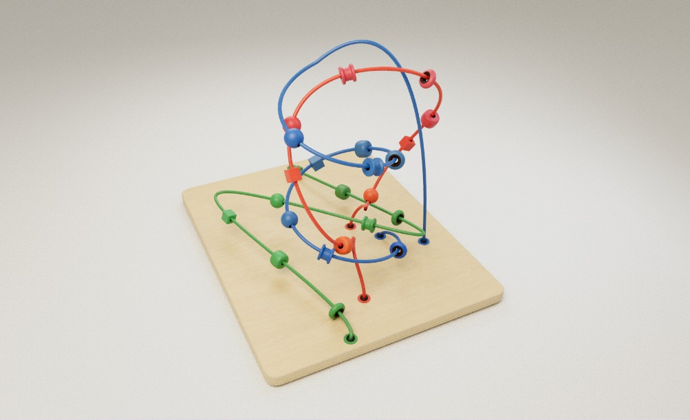
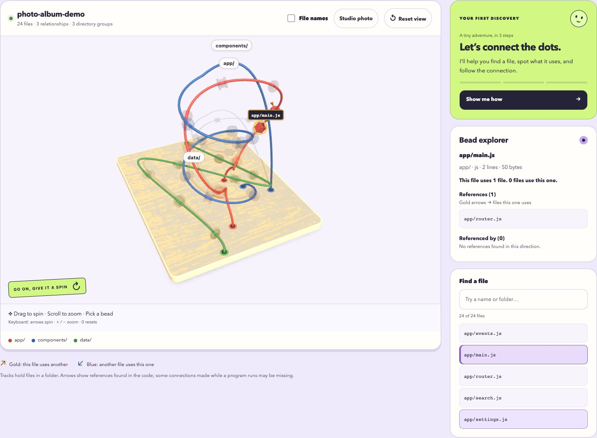

# Code Maze

**Your code, turned into a little wooden world.**

Code Maze turns the files in a software project into a colorful, interactive bead maze. Spin it around, pick a bead, and see how the pieces connect—or find your favorite angle and save a picture to show someone.



*A 24-file example project, photographed inside the app with **Studio photo**. Each bead is a file; the tracks group files by folder.*

[Try it locally](#try-it-locally) · [Show a friend](#show-a-friend) · [Technical guide](docs/readme/guide.md)

## A project you can point at

“I made this” is easier to share when there’s something to look at. Explore the shape of a project, follow a connection between two files, or turn your work into a keepsake.

- **Spin the whole thing.** Drag to orbit and scroll to get closer.
- **Pick a bead.** See which file it represents and which other files it uses.
- **Follow a tiny tour.** **Show me how** walks through one connection in three steps.



*The same example in explore mode. The gold highlight marks the selected file. Arrows show connections; the colored tracks hold folders together.*

## Try it locally

You’ll need **Node.js 22 or newer**. In a terminal:

```sh
git clone https://github.com/nicolas-found42/code-maze.git
cd code-maze
npm install
npm start
```

Open **<http://localhost:3000>**. Code Maze starts by mapping its own project, so there’s something to explore straight away. Choose **Show me how** for your first discovery.

To see your own project, enter its folder’s full path and click **Generate map**. Scanning stays on your computer; it doesn’t upload your source code or run the project’s code.

## Show a friend

1. Drag the maze to an angle you like. Turn off **File names** for a cleaner view.
2. Choose **Studio photo** once the toy has finished preparing. Hold the view still while the lighting refines.
3. Click **Save photo** to download a PNG, ready to send or post.

Want them to spin it themselves? [Export an interactive viewer](docs/readme/guide.md#save-and-export-a-map) you can host as a static site. The shared viewer shows the saved map; scanning a different folder needs the local app.

## Under the wooden hood

The maze shows connections the scanner can find in the files. It won’t capture every connection made while a program runs. [Supported languages and limits →](docs/readme/guide.md#what-the-scanner-maps)

If a scan ever fails, the failure is recorded with enough context to diagnose later — operation id, error category, and what the browser was doing at the time. See [diagnostics & evidence](docs/observability.md) or run `node scripts/evidence.mjs summary`.

For keyboard controls, rendering details, CLI exports, tests, and project history, see the [technical guide](docs/readme/guide.md).

[MIT license](LICENSE) · [Third-party libraries and assets](docs/vendor/fidelity-libraries.md) · [Original bead maze material](docs/readme/guide.md#original-bead-maze-material)
